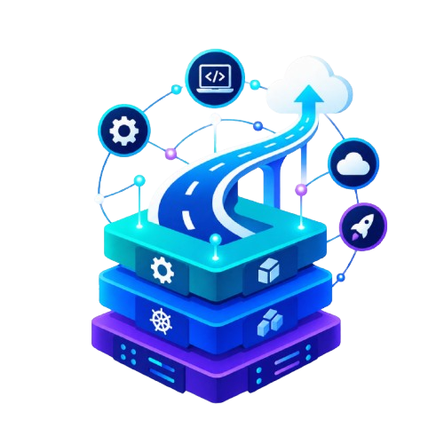
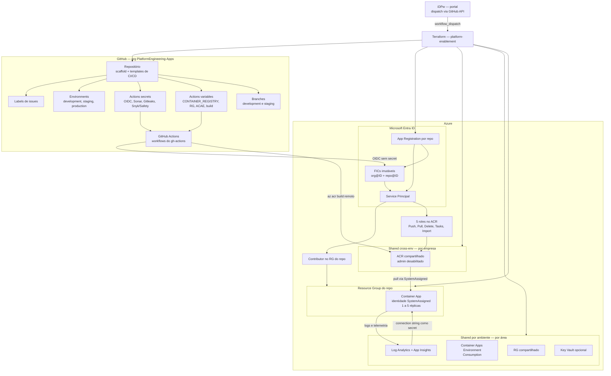

  

# Platform Engineering — Internal Developer Platform (iDPw)

Plataforma de **Platform Engineering** para provisionamento self-service de repositórios e infraestrutura Azure: o desenvolvedor preenche um formulário no portal (**iDPw**) e a plataforma cria o repositório na org `PlatformEngineering-Apps` já com scaffold do framework, CI/CD, projeto SonarCloud, App Registration com OIDC (sem secrets), Resource Groups e o destino de deploy (ACA, AKS, App Service, Functions ou Static Web App).

Este repositório (`.github`) guarda a apresentação e o mapa da plataforma. **A documentação detalhada de cada componente vive no respectivo repositório** — esta página apenas apresenta e aponta.

---

## Visão geral

---

## Mapa dos repositórios

| Repositório | Papel | Documentação |
| --- | --- | --- |
| [iDPw](https://github.com/PlatformEngineering-Core/iDPw) | Portal web (React/Vite em Azure Static Web App) que dispara os workflows de create/destroy/recreate via API do GitHub. Login com GitHub + Microsoft (Easy Auth, role `idp_user`). | [README](https://github.com/PlatformEngineering-Core/iDPw#readme) — setup local, Easy Auth, MI/FIC, convites de usuário, CI/CD |
| [platform-enablement](https://github.com/PlatformEngineering-Core/platform-enablement) | Orquestrador: workflows `terraform-create/destroy/recreate` que criam repo, branches, scaffold, SonarCloud, App Registration (OIDC), RGs, ACR compartilhado e infra do deploy target. | [README](https://github.com/PlatformEngineering-Core/platform-enablement#readme) — pré-requisitos, secrets, estrutura dos estados Terraform, infra compartilhada |
| [gh-actions](https://github.com/PlatformEngineering-Core/gh-actions) | Workflows reutilizáveis e composite actions de build/test/segurança/deploy por stack (.NET, Java, Node, Python, React), chamados pelos repos criados. | [README](https://github.com/PlatformEngineering-Core/gh-actions#readme) — contratos (inputs/secrets) de cada workflow |
| [gh-runners](https://github.com/PlatformEngineering-Core/gh-runners) | Runners efêmeros self-hosted por stack (`dotnet`, `java`, `node`, `python`) rodando como **Azure Container Apps Jobs** com scale-to-zero via KEDA. | [README](https://github.com/PlatformEngineering-Core/gh-runners#readme) e [docs/GITHUB-APP-SETUP.md](https://github.com/PlatformEngineering-Core/gh-runners/blob/main/docs/GITHUB-APP-SETUP.md) |

---

## Base necessária (ordem de setup)

Tudo que precisa existir **antes** de a plataforma provisionar o primeiro repositório. Cada item aponta para a doc que tem o passo a passo completo.

### 1. Service Principal da automação (Entra ID)

Identidade que os workflows do `platform-enablement` usam para criar RGs, App Registrations e atribuir roles no Azure.

- Script: [`scripts/New-TerraformInfrastructureServicePrincipal.ps1`](https://github.com/PlatformEngineering-Core/platform-enablement/blob/main/scripts/New-TerraformInfrastructureServicePrincipal.ps1)
- Detalhes: [platform-enablement → Pré-requisitos §1](https://github.com/PlatformEngineering-Core/platform-enablement#1-service-principal-no-microsoft-entra-id)

### 2. Storage Account para os estados do Terraform

Todos os `tfstate` e tfplans ficam em blobs de um Storage Account (por repo e por infra compartilhada), container `projects-states`. O nome da conta está no `env.STORAGE_ACCOUNT_NAME` dos workflows.

- Criação da conta, container e SAS token: [platform-enablement → §2 Storage Account](https://github.com/PlatformEngineering-Core/platform-enablement#2-storage-account-para-estado-do-terraform)
- Estrutura de blobs esperada: mesma seção da doc acima.

### 3. Runners self-hosted (Azure Container Apps Jobs)

Os pipelines de build/deploy dos repos criados rodam em runners efêmeros (`runs-on: [self-hosted, <stack>]`), escalados do zero pelo KEDA a cada webhook do GitHub.

- Setup do GitHub App e dos Jobs: [gh-runners → docs/GITHUB-APP-SETUP.md](https://github.com/PlatformEngineering-Core/gh-runners/blob/main/docs/GITHUB-APP-SETUP.md)
- Arquitetura e entrypoint: [gh-runners → README](https://github.com/PlatformEngineering-Core/gh-runners#readme)

### 4. Secrets e Environments do platform-enablement

Secrets por empresa (GitHub Environment), incluindo `AZURE_CREDENTIALS`, SAS token do storage, PAT com escopo de criação de repos (`TF_VAR_GITHUB_TOKEN`) e tokens SonarCloud/Gitleaks/etc.

- Script interativo: [`scripts/New-EnvAndSecretsByCompany.ps1`](https://github.com/PlatformEngineering-Core/platform-enablement/blob/main/scripts/New-EnvAndSecretsByCompany.ps1)
- Tabela completa de secrets: [platform-enablement → Secrets dos workflows](https://github.com/PlatformEngineering-Core/platform-enablement#secrets-dos-workflows)
- Copiar um environment inteiro (regras, variables e secrets) para outro nome: workflow **Copy GitHub Environment** (`copy-environment.yml`) no platform-enablement.

### 5. iDPw (portal)

O portal tem identidade OIDC própria e autenticação de usuários via Easy Auth — ambos **sem secrets de longa duração** (Managed Identity + FIC para o provedor Microsoft; o único secret real é o do GitHub OAuth App).

- Bootstrap da identidade OIDC do repo: [`scripts/New-OidcIdentity.ps1`](https://github.com/PlatformEngineering-Core/iDPw/blob/main/scripts/New-OidcIdentity.ps1)
- Registro dos provedores de login, MI/FIC e convites de usuário (role `idp_user`): [iDPw → Acesso](https://github.com/PlatformEngineering-Core/iDPw#acesso)
- CI/CD (cria RG + SWA se não existirem, aplica app settings e publica): [iDPw → CI/CD](https://github.com/PlatformEngineering-Core/iDPw#cicd)

---

## Conceitos-chave

- **Sem credenciais de longa duração**: GitHub Actions → Azure via OIDC com Federated Identity Credentials imutáveis (`org@ID`/`repo@ID`); SWA → Entra via Managed Identity + FIC; ACA → ACR via identidade `SystemAssigned` (pull sem senha). Explicação completa: [iDPw → O que são MI e FIC](https://github.com/PlatformEngineering-Core/iDPw#o-que-s%C3%A3o-mi-e-fic-e-por-que-n%C3%A3o-h%C3%A1-client-secret).
- **ACR é o único container registry**: um ACR compartilhado **por empresa** (criado no job `terraform-azure-shared-cross-infra`), com build remoto via `az acr build` (sem Docker daemon no runner).
- **Infra compartilhada em dois níveis**: cross-env (ACR, por empresa) e por ambiente (RG/Logs/ACAE/Key Vault, por área + `-dev`/`-hom`/prd). Detalhes: [platform-enablement → Infraestrutura compartilhada](https://github.com/PlatformEngineering-Core/platform-enablement#infraestrutura-compartilhada-por-%C3%A1rea-iac-shared-e-iac-shared-cross).
- **Rastreabilidade**: toda solicitação do portal gera um `control_id` (`REQ-AAAAMMDD-XXXXXXXX`) que aparece no nome da execução do workflow — [iDPw → Rastreamento](https://github.com/PlatformEngineering-Core/iDPw#rastreamento-das-solicita%C3%A7%C3%B5es).
